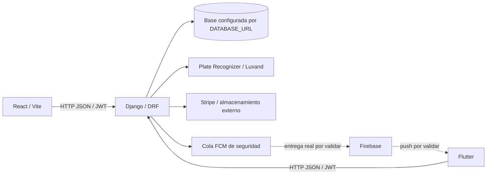
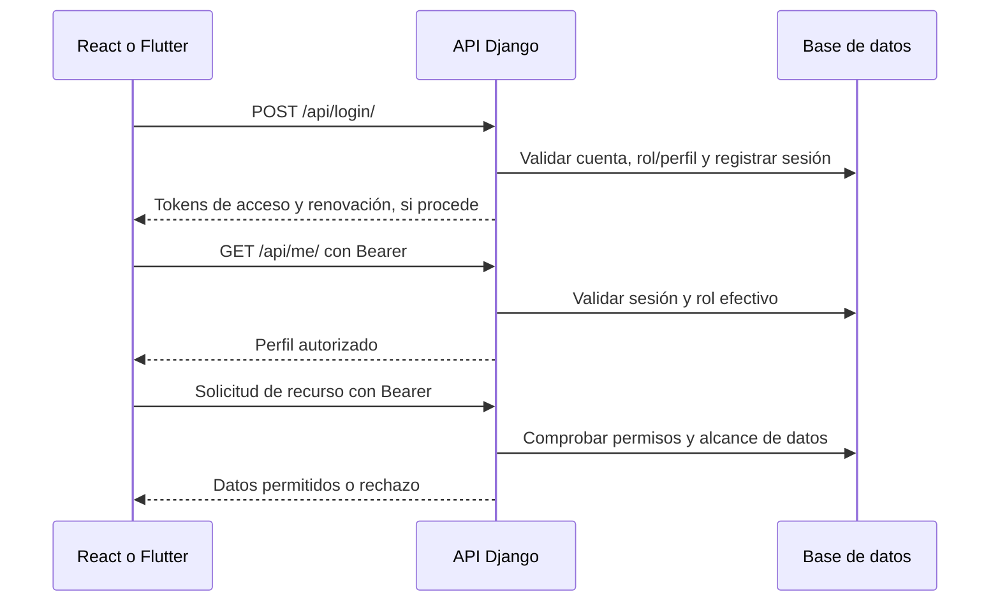

# Arquitectura

Revisión estática: 2026-10-31. Versiones declaradas, no inventario de todos los entornos instalados: Django 5.2.6, DRF 3.16.1 y SimpleJWT 5.5.1 en [requirements](../Condominio-Backend/requirements.txt); React `^19.1.1`, Vite `^7.1.6` y Axios en [package.json](../Condominio-Frontend/package.json); Flutter/Dart con restricción SDK `^3.8.0` en [pubspec](../condominio-movil/pubspec.yaml).

| Componente | Organización real |
| --- | --- |
| Django | `condominioBACK` configura aplicaciones, URL y WSGI/ASGI; `administracion` maneja usuarios, perfiles, roles, sesiones y alta de cuentas |
| Dominio | `residencial` contiene residentes, visitas, vehículos, unidades y recursos comunes; `finanzas` contratos, expensas, multas y pagos |
| Seguridad | `seguridad_IA` contiene reconocimiento, eventos, historial, bandeja y cola FCM; `core/luxand.py` es un cliente compartido, no aparece como app instalada |
| Web | React JavaScript/JSX; `src/api`, `src/auth`, `src/components`, `src/pages`, `src/routers`; Vite, Axios y Tailwind |
| Móvil | Flutter/Dart; `lib/models`, `services`, `pages`, `security`, `config`; HTTP, almacenamiento seguro y complementos Firebase |

La base se configura con `DATABASE_URL` mediante `dj_database_url` en `condominioBACK/settings.py`. PostgreSQL es el entorno previsto y tiene pruebas aisladas documentadas; SQLite en memoria se usa en pruebas. No se leyó `.env` ni se consultó la base persistente. No afirmar qué servidor o base está activo a partir de estos documentos.

## Autenticación y comunicación

`condominioBACK/urls.py` incluye las cuatro aplicaciones bajo `/api/`; Django Admin está montado en la raíz. Las rutas de autenticación verificadas son `/api/login/`, `/api/me/`, `/api/refresh/`, `/api/logout/`; el alta vinculada utiliza `/api/provisionar-cuenta/`. Seguridad registra `/api/eventos-seguridad/` y `/api/notificaciones-seguridad/`.

El backend usa `ApplicationJWTAuthentication`; los permisos se fijan explícitamente en las vistas y se filtran consultas. El valor global de DRF sigue siendo `AllowAny`: revisar toda nueva vista, no asumir protección automática. También persisten `ALLOWED_HOSTS` con comodín y `CORS_ALLOW_ALL_ORIGINS=True`; no se corrigieron en esta etapa.

## Ejecución y evolución

El desarrollo utiliza Django local, Vite y Android. Los puertos y URLs concretos deben comprobarse por proceso; no están garantizados por el historial. Existen archivos de despliegue del backend y referencias a Railway; no se verificó un despliegue activo ni se aprobó su configuración final.

La futura visión local enviará eventos relevantes al backend, potencialmente alojado en nube, y conservará trabajo pendiente si pierde conexión. El contrato de ingestión, autenticación, almacenamiento y sincronización aún debe diseñarse. Ver [seguridad IA](seguridad-ia.md). El reconocimiento actual por fotografía no es procesamiento continuo.
