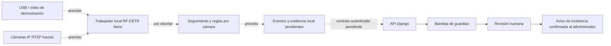

# Seguridad inteligente

2026-11-16: la web permite seleccionar inferencia local o un servicio propio RF-DETR Nano por HTTPS, por pestaña. Las reglas siguen en el cliente; el monitor independiente conserva su configuración. La infraestructura remota aún no existe ni se ha probado con imágenes reales. Ver `Condominio-Backend/seguridad_vision/IA_POR_INTERNET.md`.

2026-11-16: la regla de piscina advierte por una persona detectada en la zona y ninguna otra detectada en la imagen durante el tiempo configurado. Está disponible en análisis web de video y vistas en vivo, con guardado por cámara de red o por dispositivo local en el navegador. Es una detección orientativa, no identifica edad ni ahogamientos, y no reemplaza vigilancia humana. Probada con fuentes simuladas.

2026-11-15: en la webcam, la consulta puntual de placa captura bajo demanda y la lectura automática requiere activación explícita. Ambas usan Plate Recognizer mediante el flujo existente; no identifican automáticamente al conductor ni vinculan por sí solas una placa a una incidencia.

2026-11-15: la zona y el registro automático de las cámaras de red del catálogo se guardan por cámara y se evalúan en la vista web activa, con evidencia para el flujo de guardias. La webcam guarda su zona y ajustes por dispositivo en el navegador. No constituye un servicio continuo independiente ni se validó aún con cámara adicional física.

2026-11-07: las cámaras de red adicionales admiten configuración de zona e historial propios; esa configuración aún no genera detecciones ni notificaciones. Imou conserva su zona y proceso anteriores. [Detalle](../documentacion/seguridad/ZONAS_CAMARAS_CATALOGO.md).

2026-11-07: cámaras adicionales RTSP activas pueden seleccionarse para vista local mediante un puente separado; todavía no tienen zonas ni eventos propios. [Detalle](../documentacion/seguridad/MONITOR_CAMARAS_CATALOGO.md).

2026-11-07: el monitor Imou admite una fuente vinculada al catálogo, con configuración cifrada y actualización de IP desde gestión; el archivo local permanece como respaldo antes de la vinculación. Activación y comprobación reales pendientes. [Detalle](../documentacion/seguridad/MONITOR_IMOU_CATALOGO.md).

Actualización: 2026-10-31. La [auditoría del 29 de octubre](../documentacion/auditorias/Auditoria_tecnica_seguridad_IA_condominio.docx) propuso YOLO. La orientación posterior solicitada es **evaluar e integrar RF-DETR Nano**. Ninguno está integrado como procesador continuo en el código revisado. No instalar modelos o dependencias en una etapa meramente documental.

## Existente

Desde 2026-11-05 hay una vista local Imou por RTSP: `imou_local.py` mantiene
imágenes JPEG en memoria fuera de Django; una pasarela autenticada las entrega
a React para administrador/guardia en la misma laptop. Se abre bajo demanda
y libera por inactividad. La webcam existente se conserva. El usuario confirmó
haber probado la vista y mostró detecciones en ella. Se puede activar RF-DETR
en un panel separado; posteriormente confirmó una alerta móvil desde la Imou.
No hay grabación de video. [Alcance](../documentacion/seguridad/CONEXION_IMOU_LOCAL.md).

La vista Imou permite dibujar en el fotograma analizado una zona temporal,
oculta por defecto, y estimar permanencia para marcar posibles vehículos
detenidos en rojo. En la etapa inicial no creaba eventos; las pruebas de zona
fueron simuladas y su validación real sigue pendiente. [Detalle](../documentacion/seguridad/ZONA_IMOU_TEMPORAL.md).

Tras aprobación posterior, el operador puede activar registro desde la Imou:
la página utiliza la API manual existente y la distribución a guardias. No es
vigilancia autónoma. El usuario confirmó la entrega móvil de una detección
real de Imou. Posteriormente se añadió una imagen privada del fotograma para
eventos nuevos; falta probar esa evidencia en sesiones reales web y móvil.
[Detalle](../documentacion/seguridad/EVIDENCIA_IMOU.md).

La prueba inicial RF-DETR está organizada en
`Condominio-Backend/seguridad_vision/` y se ejecuta en un entorno independiente
del de Django. Detectó objetos en fotogramas de un video público; ahora puede
procesar el archivo completo y guardar una copia anotada. No constituye todavía
el servicio final de cámaras ni una integración de detecciones con alertas.
Ver [informe](../documentacion/seguridad/PRUEBA_INICIAL_RFDETR.md).

Existe ahora una prueba de cámara local iniciada voluntariamente desde la web
con inferencia en un proceso separado. Está limitada al mismo equipo y el
usuario confirmó que ve la cámara y los recuadros; no es el servicio de cámaras final.
[Informe inicial](../documentacion/seguridad/CAMARA_LOCAL_DEMOSTRACION.md).

La prueba de cámara ahora permite una zona temporal, oculta por defecto tras
dibujarla, y recuadro rojo ante posible permanencia. Si el operador habilita
el registro, la página usa la API manual existente para crear un evento.
No guarda la zona ni evidencia y no es ingesta autónoma; el seguimiento se
reinicia con muestras demasiado separadas. [Detalle](../documentacion/seguridad/REGISTRO_CAMARA_DEMOSTRACION.md).

La web también permite seleccionar un archivo de video y analizar muestras
con ese mismo procesador local. El archivo completo no se almacena en el
servidor y no se generan alertas. Tras el análisis se pueden comparar el
original y una vista anotada sincronizada, con recuadros por muestras que
pueden no coincidir exactamente con objetos en movimiento.
Ver [informe](../documentacion/seguridad/VIDEO_ARCHIVO_DEMOSTRACION.md).

Desde el 2026-11-04 se puede dibujar una zona temporal en el video seleccionado
y estimar permanencias de vehículos con seguimiento sencillo en el navegador.
Si el operador activa la opción, la página registra eventos mediante la API
existente. La zona no se guarda y la integración operativa de cámara sigue
pendiente. [Detalle](../documentacion/seguridad/REGISTRO_AUTOMATICO_VIDEO.md).

Un resultado de video puede preparar el formulario de evento manual; el usuario
revisa y envía voluntariamente. El envío usa el flujo existente, que distribuye
avisos a guardias, y no constituye ingesta automática de IA ni adjunta video.
[Detalle](../documentacion/seguridad/VIDEO_PREPARAR_EVENTO.md).

La opción automática para video utiliza también la API manual: conserva el actor
humano y describe su procedencia, pero no es una ingesta autenticada del
trabajador de IA. Puede haber duplicados entre ejecuciones o tras perder una
identidad temporal. [Informe](../documentacion/seguridad/REGISTRO_AUTOMATICO_VIDEO.md).

La reproducción del video público fijo fue retirada a petición del usuario
el 2026-11-02. La prueba histórica sigue documentada en el
[informe web](../documentacion/seguridad/VIDEO_DEMOSTRACION_WEB.md).

Plate Recognizer procesa fotografías de matrículas y persiste `LecturaPlaca`; Luxand realiza reconocimiento/enrolamiento facial en nube. Se conservan esos flujos. Los eventos, notificaciones internas e historial permiten registrar y revisar hechos manuales; la API de creación existente no constituye una ingestión autenticada de IA. Los campos textuales de cámara/ubicación no son modelos de cámaras ni permisos sobre ellas.

## Estrategia solicitada, aún por implementar

- Servicio local independiente de las peticiones Django. Webcam USB inicial, arquitectura de 1 a N fuentes y futuras cámaras IP por RTSP.
- Seguimiento y estado separados por cámara; reconexión, identificación de fuente y control de carga. Evaluar video grabado para demostración reproducible.
- Personas, vehículos, perros y gatos solo si esas clases existen en los pesos elegidos. Verificar taxonomía antes de prometer otras detecciones.
- Convertir detecciones en eventos relevantes mediante reglas, tiempos y deduplicación; no transmitir cada fotograma al backend ni convertir automáticamente una detección en multa.
- Evidencia privada con permisos, trazabilidad y retención; confirmar incidencias mediante revisión humana.
- Inferencia local sin internet tras preparar dependencias y pesos. Cola local y sincronización posterior con identificadores estables, reintentos e idempotencia: diseño pendiente.

La operación offline se refiere al trabajador futuro. Luxand, Plate Recognizer Cloud, FCM y otros proveedores actuales necesitan internet. Un backend en nube tampoco estará disponible durante una caída de conexión local.

Antes de seleccionar ejecución CPU/GPU o exportación, medir hardware real, RAM/VRAM, FPS, latencia, consumo y número de cámaras. No se verificaron aquí el equipo objetivo, rendimiento, licencia de código/pesos, compatibilidad de exportadores ni costes de proveedores. Estas comprobaciones pertenecen a una etapa autorizada de evaluación, con fuentes oficiales vigentes.
# Zona compartida de la Imou local (2026-11-05)

El administrador configura la zona, el tiempo y el registro automático para la única fuente Imou local. Los guardias consultan la configuración sin modificarla. La zona persiste en Django; la vigilancia sigue requiriendo una sesión activa y los servicios locales. [Alcance y límites](../documentacion/seguridad/ZONA_IMOU_COMPARTIDA.md).

La zona y sus opciones se guardan automáticamente tras completar el dibujo o la edición; eliminar requiere confirmación y desactiva el registro. Los fallos se informan y deben reintentarse. [Flujo vigente](../documentacion/seguridad/GUARDADO_AUTOMATICO_ZONA_IMOU.md).

Desde 2026-11-05 existe un monitor local Imou separado del navegador, con inicio manual y dependencias de cámara, IA y base locales. Utiliza la zona compartida, registra eventos IA con evidencia y entrega a guardias mediante la cola existente. No se ha probado con cámara real en esta etapa ni tiene inicio automático o cola durable. [Alcance](../documentacion/seguridad/MONITOREO_IMOU_INDEPENDIENTE.md).

Desde 2026-11-06 existe el catálogo administrativo `camaras`, independiente de la integración Imou actual. La integración multifuente y zonas/eventos por cámara siguen pendientes. Los avisos a residentes y la lectura automática de matrículas son propuestas posteriores. [Plan](../documentacion/seguridad/PLAN_CAMARAS_Y_AVISOS_RESIDENTES.md).

El catálogo puede identificar la Imou existente por coincidencia única de dirección y puerto y solicitar una comprobación local al puente. No es aún una relación estable ni soporte genérico de cámaras. Prueba física pendiente por RTSP inaccesible. [Alcance](../documentacion/seguridad/VINCULO_IMOU_CATALOGO.md).

La navegación web separa **Cámaras → Monitor en vivo** (administrador y guardia), **Cámaras → Gestión de cámaras** (administrador) y **Seguridad → Eventos e incidencias** (administrador). El guardia conserva revisión de eventos en el monitor y por la API. [Detalle](../documentacion/seguridad/MENU_MONITOR_CAMARAS.md).

El catálogo de cámaras de red admite usuario, ruta RTSP y contraseña cifrada que no se devuelve en la API. La conexión RTSP genérica todavía no utiliza estos datos; la Imou conserva su configuración local anterior. [Detalle](../documentacion/seguridad/CREDENCIALES_CAMARAS.md).

2026-11-15: el administrador puede eliminar cámaras del catálogo solo cuando no existan referencias protegidas; se registra auditoría. Las cámaras vinculadas al monitor o a zonas/historial protegido deben conservarse o deshabilitarse. La selección del mosaico es temporal y ocultar una vista no detiene su captura.

2026-11-16: La pasarela remota admite proveedor Roboflow alojado mediante clave privada en entorno. Conexi?n real a?n no verificada.

2026-11-16: Regla de posible mascota en zona restringida: perros y gatos, aviso inmediato por defecto, configuracion por camara y evaluacion de video o vista activa. No identifica al animal ni a su dueno; el guardia confirma. Validada con fuentes simuladas.
