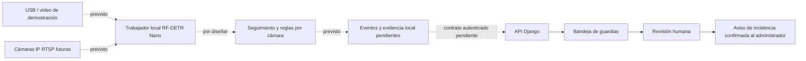

# Seguridad inteligente

Actualización: 2026-10-31. La [auditoría del 29 de octubre](../documentacion/auditorias/Auditoria_tecnica_seguridad_IA_condominio.docx) propuso YOLO. La orientación posterior solicitada es **evaluar e integrar RF-DETR Nano**. Ninguno está integrado como procesador continuo en el código revisado. No instalar modelos o dependencias en una etapa meramente documental.

## Existente

La prueba inicial RF-DETR está organizada en
`Condominio-Backend/seguridad_vision/` y se ejecuta en un entorno independiente
del de Django. Detectó objetos en fotogramas de un video público; ahora puede
procesar el archivo completo y guardar una copia anotada. No constituye todavía
el servicio final de cámaras ni una integración de detecciones con alertas.
Ver [informe](../documentacion/seguridad/PRUEBA_INICIAL_RFDETR.md).

Existe ahora una prueba de cámara local iniciada voluntariamente desde la web
con inferencia en un proceso separado. Está limitada al mismo equipo y el
usuario confirmó que ve la cámara y los recuadros; no es el servicio de cámaras final ni
genera eventos o alertas. [Informe](../documentacion/seguridad/CAMARA_LOCAL_DEMOSTRACION.md).

La web también permite seleccionar un archivo de video y analizar muestras
con ese mismo procesador local. El archivo completo no se almacena en el
servidor y no se generan alertas. Tras el análisis se pueden comparar el
original y una vista anotada sincronizada, con recuadros por muestras que
pueden no coincidir exactamente con objetos en movimiento.
Ver [informe](../documentacion/seguridad/VIDEO_ARCHIVO_DEMOSTRACION.md).

La reproducción del video público fijo fue retirada a petición del usuario
el 2026-11-02. La prueba histórica sigue documentada en el
[informe web](../documentacion/seguridad/VIDEO_DEMOSTRACION_WEB.md).

Plate Recognizer procesa fotografías de matrículas y persiste `LecturaPlaca`; Luxand realiza reconocimiento/enrolamiento facial en nube. Se conservan esos flujos. Los eventos, notificaciones internas e historial permiten registrar y revisar hechos manuales; la API de creación existente no constituye una ingestión autenticada de IA. Los campos textuales de cámara/ubicación no son modelos de cámaras ni permisos sobre ellas.

## Estrategia solicitada, aún por implementar

- Servicio local independiente de las peticiones Django. Webcam USB inicial, arquitectura de 1 a N fuentes y futuras cámaras IP por RTSP.
- Seguimiento y estado separados por cámara; reconexión, identificación de fuente y control de carga. Evaluar video grabado para demostración reproducible.
- Personas, vehículos, perros y gatos solo si esas clases existen en los pesos elegidos. Verificar taxonomía antes de prometer otras detecciones.
- Convertir detecciones en eventos relevantes mediante reglas, tiempos y deduplicación; no transmitir cada fotograma al backend ni convertir automáticamente una detección en multa.
- Evidencia privada con permisos, trazabilidad y retención; confirmar incidencias mediante revisión humana.
- Inferencia local sin internet tras preparar dependencias y pesos. Cola local y sincronización posterior con identificadores estables, reintentos e idempotencia: diseño pendiente.

La operación offline se refiere al trabajador futuro. Luxand, Plate Recognizer Cloud, FCM y otros proveedores actuales necesitan internet. Un backend en nube tampoco estará disponible durante una caída de conexión local.

Antes de seleccionar ejecución CPU/GPU o exportación, medir hardware real, RAM/VRAM, FPS, latencia, consumo y número de cámaras. No se verificaron aquí el equipo objetivo, rendimiento, licencia de código/pesos, compatibilidad de exportadores ni costes de proveedores. Estas comprobaciones pertenecen a una etapa autorizada de evaluación, con fuentes oficiales vigentes.
